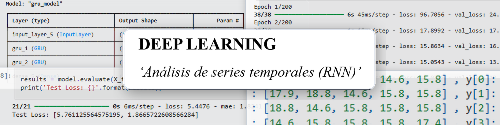

## Proyecto

_ES_:
Notebook práctico para aprender sobre la arquitectura y aplicación de redes neuronales recurrentes (RNN) sobre series temporales.

_EN_:
Practical notebook to learn about the architecture and application of recurrent neural networks (RNN) on time series.

## Descipción de archivos

| Archivo | Descripción |
|---|---|
| test_redesneuronales_seriestemporales.ipynb | Notebook |
